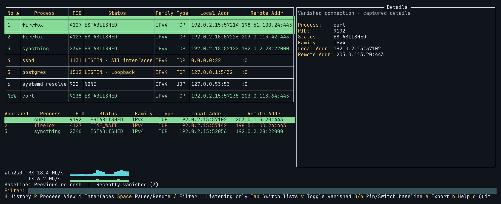

_Disclaimer: This project was made with the assitance of Codex

# BatStat 🦇📊  

A **terminal user interface (TUI) tool** for monitoring, analyzing, and managing network connections in real time.  

---

## Table of Contents  
- [Main Interface](#main-interface)  
- [Features](#features)  
  - [Interface traffic](#interface-traffic)
  - [Process View](#process-view)
  - [Connection History](#connection-history)
  - [Process Management](#process-management)  
  - [Network Diagnostics](#network-diagnostics)  
  - [Export to CSV](#export-to-csv)  
  - [In-App Help Panel](#in-app-help-panel)  
- [Installation](#installation)  
- [Usage](#usage)  
- [Contributing](#contributing)  
  - [Release versioning](#release-versioning)
- [License](#license)  

---

## Main Interface  

The main view provides a **two-pane layout**:  

- **Left Pane:** Live-updating list of connections  
- **Right Pane:** Detailed information for the selected connection  

This design makes it easy to monitor and analyze network activity efficiently.  



---

## Features  

### 🔴 Live Monitoring  
- Auto-refreshes the connection list every few seconds  
- Press `Space` to pause or resume monitoring. While paused, you can browse, filter, sort, and export the last displayed connections with `e`.
- Live user and command details and process termination become available again after the first successful refresh on resume.
- Live rows show `NEW` for one successful refresh when they were absent from the previous snapshot. The Recently vanished list keeps up to 20 entries for three successful refreshes. Press `Tab` to switch lists or `v` to collapse or expand the vanished list.
- Press `B` to pin the full displayed connection snapshot for this session. Press `b` to switch between the previous-refresh and pinned comparisons. The pinned view shows all differences from the pin, and the filter applies to both lists.
- Press `/` to search process names, states, address families, and addresses. Combine exact filters such as `pid:1234 proto:tcp state:listen` with each other or with search text.
- Press `L` to toggle **Listening only** alongside the current filter. TCP listeners are marked **Loopback** or **All interfaces** when bound to a loopback or wildcard address for their address family.
- Color-coded connection states (`ESTABLISHED`, `LISTEN`, `CLOSE_WAIT`, etc.)  

### 📑 Two-Pane Layout  
- View all connections and details simultaneously  
- Column sorting:  
  - Press `s` → cycle through sortable columns  
  - Press `S` → toggle ascending/descending order  

### Interface traffic

- The strip shows the selected interface's receive (RX) and transmit (TX) rates over the past minute, sampled every three seconds. The two graphs share a scale. Short terminals show the latest rates on one line.
- Press `i` to choose an interface in Connections, Process View, or History. BatStat keeps a minute of history for every interface and selects the busiest non-loopback interface over the first measured interval. On a quiet system, it picks the first up, non-loopback interface by name, with loopback as a fallback.
- Interface traffic stays live when you pause connection monitoring or filter the connection list. Gaps mark missing rate readings, and a disconnected selection stays visible as **Unavailable**.

### Process View

- Press `P` to switch between Connections and Process View. Groups show the total, established TCP connections, and TCP listeners for each PID, with the largest groups first. Unattributed sockets appear under **Unknown owner**.
- Press Enter to expand or collapse a group. Select an endpoint to inspect it or run a connection action. Press `s` and `S` to change endpoint order.
- `/` and `L` filter both the counts and the expanded endpoints. CSV export includes all matching live endpoints, including those in collapsed groups. Switch to Connections for snapshot comparisons.

### Connection History

- Press `H` from Connections or Process View to inspect active and vanished connections, with the most recently vanished first. The details pane shows first seen, last seen, first missing, and observed state changes. Press `Tab` to focus and scroll the timeline, or `H` to return.
- History records successful snapshots from the existing three-second refresh. Pause freezes the timeline, and connections that open and close between snapshots can be missed. History labels records **Identity uncertain** when more than one socket match is plausible.
- History is kept in memory for the session, with room for 2,048 active records, 2,048 vanished records, and the latest 16 state changes per record. When the active limit is reached, History keeps tracking its existing active records and shows how many live connections are outside History.
- `/` and `L` filter each record's latest observation. Return to the previous view to run endpoint actions or export live connections.

### ⚙️ Process Management  
- `k` → Gracefully kill process for selected connection  
- `K` → Force kill with `SIGKILL`  

### 🌐 Network Diagnostics  
- `p` → Ping remote address in a live modal overlay  

### 📂 Export to CSV  
- `e` exports filtered live connections to `batstat_export.csv` or a custom path.

### ❓ In-App Help Panel  
- `h` → Toggle a detailed, colorful panel with all keybindings  

---

## Installation  

Requires **Go 1.25+**.  

Install the latest version.
```bash
go install github.com/MrBrooks89/BatStat/cmd/BatStat@latest
```
To pin a version, use its tag.
```bash
go install github.com/MrBrooks89/BatStat/cmd/BatStat@v0.4.1
```

Make sure your `GOPATH/bin` is in your `$PATH`:  
👉 [Go Wiki: Setting GOPATH](https://go.dev/wiki/SettingGOPATH)  

---

## Usage  

Run BatStat:  
```bash
BatStat
```  

Press `h` at any time for a full list of keybindings.  

---

## Contributing  

PRs are welcome!  
- Open an issue for bugs or feature requests  
- Fork and submit a pull request  

### Release versioning

Git tags define BatStat's published versions. In feature and bug-fix PRs, note the recommended release bump. Apply the bump when publishing a release from a tested commit on `main` so one tag can include several PRs.

- Use a minor bump for a release that includes a new feature, such as `v0.4.0` to `v0.5.0`.
- Use a patch bump for a bug-fix-only release, such as `v0.4.0` to `v0.4.1`.

Before publishing, check the latest tag on GitHub and choose the next version based on the changes since that tag. Push the new tag and verify that it points to the tested commit.

---

## License  

MIT License — see [LICENSE](LICENSE).
